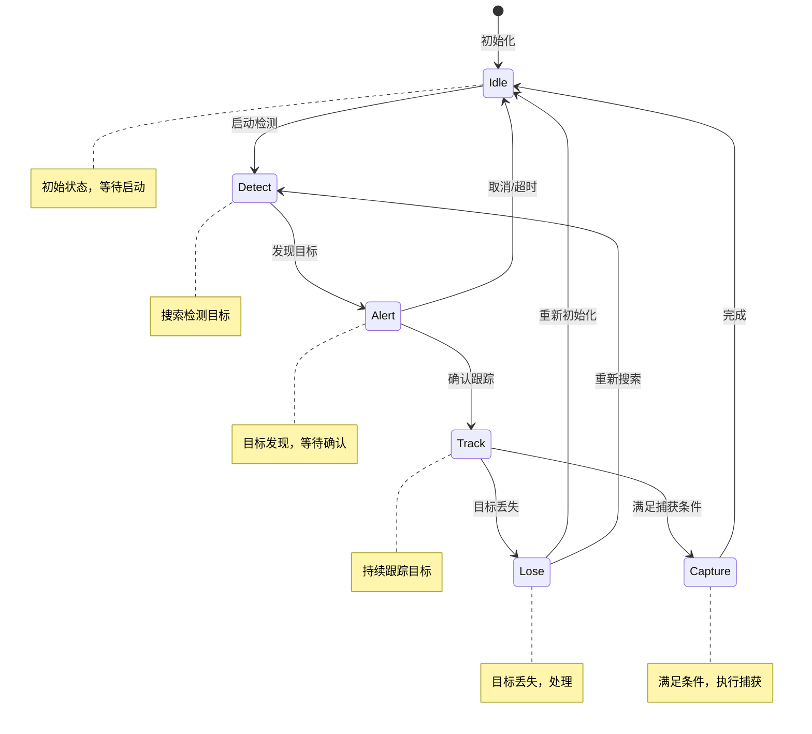
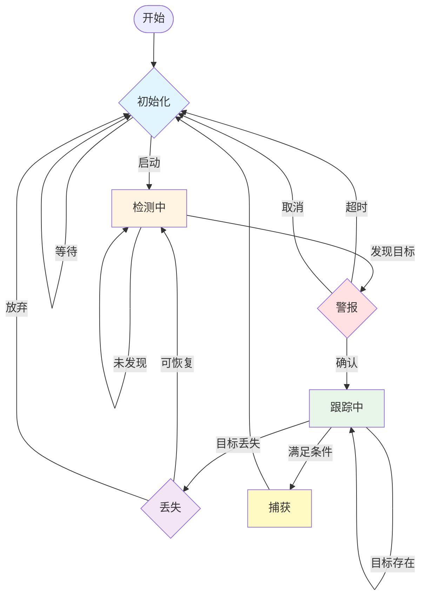

# ASFM 状态机文档

## 1. State Diagram（状态图）



---

## 2. Transition Diagram（转换图）



---

## 3. 伪代码

```
// ASFM 状态机主程序
状态 currentState = IDLE

// 主循环
while (true) {
    switch (currentState) {
        case IDLE:
            if (接收到启动信号) {
                currentState = DETECT
            }
            break

        case DETECT:
            if (检测到目标()) {
                currentState = ALERT
            }
            break

        case ALERT:
            if (确认目标()) {
                currentState = TRACK
            } else if (超时() || 取消()) {
                currentState = IDLE
            }
            break

        case TRACK:
            if (满足捕获条件()) {
                currentState = CAPTURE
            } else if (目标丢失()) {
                currentState = LOSE
            }
            // 继续跟踪...
            break

        case LOSE:
            if (可以恢复()) {
                currentState = DETECT
            } else {
                currentState = IDLE
            }
            break

        case CAPTURE:
            执行捕获()
            currentState = IDLE
            break
    }
    等待(时间间隔)
}
```

---

## 4. 学生作业

### 作业一：理解状态机

**问题：** ASFM 状态机有哪些状态？画出状态之间的转换关系。

**答案要点：**
- 共 6 个状态：Idle（空闲）、Detect（检测）、Alert（警报）、Track（跟踪）、Lose（丢失）、Capture（捕获）
- 转换关系：见上方 State Diagram

---

### 作业二：分析状态转换条件

**问题：** 从 Track 状态可以转换到哪些状态？各自的条件是什么？

**答案要点：**
| 目标状态 | 转换条件 |
|---------|---------|
| Track | 目标持续存在（自循环） |
| Lose | 目标丢失 |
| Capture | 满足捕获条件 |

---

### 作业三：补全伪代码

**问题：** 补充以下伪代码中的条件判断：

```javascript
function 状态机() {
    let state = "IDLE"

    while (true) {
        if (state === "IDLE") {
            if (__________) state = "DETECT"
        }
        else if (state === "DETECT") {
            if (__________) state = "ALERT"
        }
        else if (state === "TRACK") {
            if (__________) state = "CAPTURE"
            else if (__________) state = "LOSE"
        }
        else if (state === "LOSE") {
            if (__________) state = "DETECT"
            else state = "IDLE"
        }
        else if (state === "CAPTURE") {
            state = "IDLE"
        }
    }
}
```

**答案要点：**
- 第一个空：`接收到启动信号`
- 第二个空：`检测到目标`
- 第三个空：`满足捕获条件`
- 第四个空：`目标丢失`
- 第五个空：`可以恢复`

---

### 作业四：思考题

**问题：** 如果系统在 Track 状态下同时满足 "目标丢失" 和 "满足捕获条件"，应该优先处理哪个？为什么？

**参考答案：**
- 应该优先处理 "满足捕获条件"
- 原因：捕获是最终目标，应该在完全满足条件时立即执行；目标丢失可能是暂时性的干扰

---

*文档版本：1.0 | 创建日期：2026-05-21*
